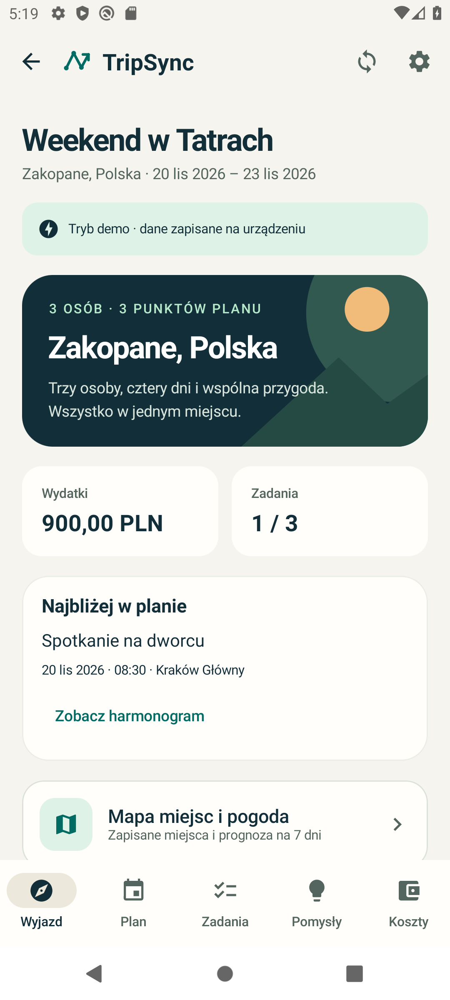
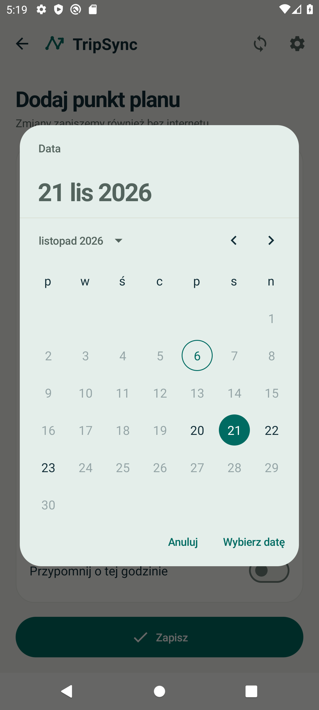
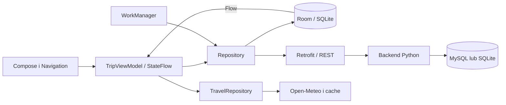

<p align="center">
  
</p>

<p align="center"><strong>Wspólny wyjazd. Jeden plan. Czytelne rozliczenia.</strong></p>
<p align="center">Android · Kotlin · Jetpack Compose · MVVM · Room · REST API</p>

# TripSync

TripSync to aplikacja Android do organizacji podróży w grupie. Łączy harmonogram, zadania, pakowanie, głosowanie, wspólne wydatki, budżety, spłaty oraz mapę miejsc i prognozę pogody. Dane są zapisywane lokalnie, a współpraca między kontami odbywa się przez własny backend REST.

**Wersja Android: 1.2.1** · **Android 8.0+** · **Projekt zespołowy**

**Wykonawcy:** Brajan Sieroń, Damian Panońko, Patryk Dawczak.

[Materiały do oddania](docs/oddanie.md) · [Dokumentacja](docs/README.md) · [Instrukcja uruchomienia](docs/uruchomienie.md) · [PDF do oddania](output/pdf/TripSync_dokumentacja_do_oddania.pdf) · [Wyniki testów](docs/testy.md) · [Znane ograniczenia](docs/ograniczenia.md)

## Zobacz aplikację

<p>
  
  
  
</p>

Zrzuty pochodzą z działającej aplikacji na emulatorze. Pokazują dane demonstracyjne oraz izolowane środowisko testowe. [Pełna galeria](docs/funkcje.md#zrzuty-ekranu).

## Co można zrobić

| Obszar | Działające funkcje |
|---|---|
| Wyjazdy i grupa | CRUD wyjazdów, konta, role organizatora i uczestnika, zaproszenia kodem lub linkiem |
| Plan | Punkty z datą, godziną i miejscem, kolejność, wykonanie i lokalne przypomnienia |
| Zadania | Zadania oraz pakowanie, przypisanie osoby, status wykonania |
| Pomysły | Propozycje, własne głosy, cofanie głosu i przeniesienie propozycji do planu |
| Koszty | Podział równy lub własne udziały, sześć kategorii, wyszukiwanie i sortowanie |
| Budżet i spłaty | Limit całkowity, limity kategorii, salda, propozycje przelewów i zapis własnych spłat |
| Miejsca i pogoda | Wspólna mapa, CRUD miejsc, wyszukiwanie miejscowości, prognoza na 7 dni i cache |
| Współpraca | Zapis offline, kolejka operacji, synchronizacja, konflikty edycji i historia zmian |
| Interfejs | Jasny i ciemny motyw, polskie daty, kalendarze, zegar 24-godzinny i ochrona formularza przy cofnięciu |

Spłata jest zapisem deklaracji użytkownika. Aplikacja nie realizuje przelewów bankowych.

## Poprawki 1.2.1

Atomowe przenoszenie pomysłów bez duplikatów, ochrona formularzy budżetu/spłaty/miejsca, poprawione przypomnienia, potwierdzenie usuwania budżetu i zerowe limity kategorii. [Opis zmian](docs/zmiany-1.2.1.md). Przed instalacją APK zaktualizuj backend do API 1.2.0 przez push i restart Wispbyte.

## Szybki start

1. Otwórz **cały katalog repozytorium** w Android Studio, zsynchronizuj Gradle i kliknij **Run**.
2. W aplikacji wybierz **Wypróbuj bez konta**, aby zobaczyć edytowalny wyjazd trzech osób bez uruchamiania backendu.
3. Do współpracy utwórz własne konto. Nowa instalacja korzysta z `https://tripsync.wisp.uno/`. Każdy uczestnik powinien używać tego samego serwera.

Pełna konfiguracja SDK, uruchomienie na Macu, emulatorze i telefonie: [uruchomienie.md](docs/uruchomienie.md).

APK debug można pobrać z artefaktu **TripSync-debug** udanego przebiegu [GitHub Actions](https://github.com/Yamoteusz/TripSync/actions). Dostępny lokalnie APK jest w `output/apk/TripSync-debug.apk`; pliki APK są wyłączone z historii Git. Workflow tworzy artefakt dopiero po udanym zbudowaniu aplikacji.

W tym samym przebiegu artefakt **TripSync-do-oddania** udostępnia paczkę PDF + APK. GitHub opakowuje artefakt własnym archiwum; właściwa paczka `TripSync_do_oddania.zip` znajduje się w środku.

## Budowanie i testy

Wymagania obecnego projektu: **JDK 17 lub 21**, Android SDK **36.1**, Build Tools **36.0.0**. W lokalnej weryfikacji użyto JDK 21. Konfiguracja wersji 1.2: compile SDK 36.1, target SDK 36, min SDK 26.

```sh
./gradlew :app:assembleDebug :app:testDebugUnitTest :app:lintDebug
python3 -m unittest discover -s backend -v
```

Na macOS pliki kompilacji powstają automatycznie poza repozytorium w `~/.gradle/tripsync-builds/<identyfikator-katalogu>/app/`, aby synchronizacja Dokumentów nie tworzyła kopii plików `.class`. Na pozostałych systemach pozostaje `app/build/`. Możesz jawnie wskazać katalog:

```sh
./gradlew -PtripsyncBuildRoot=/tmp/tripsync-build :app:assembleDebug
```

APK powstanie wtedy w `/tmp/tripsync-build/app/outputs/apk/debug/app-debug.apk`. `sh scripts/build.sh` wykonuje budowanie, lint, testy jednostkowe i backendu oraz kopiuje APK do `output/apk/`.

Pełny udokumentowany przebieg bazowy z **06.11.2026**:

| Grupa | Wynik |
|---|---:|
| Testy jednostkowe Android | 23 / 23 |
| Testy urządzeniowe: UI i integracja | 31 / 31 |
| Testy backendu | 45 / 45 |
| Razem, bez powtórnych przebiegów | **99 / 99** |
| Lint | 0 błędów, 1 ostrzeżenie GradleDependency w przebiegu offline |

Testy urządzeniowe wykonano na API 29; wybór daty i godziny dodatkowo sprawdzono przy szerokości 320 dp oraz skali czcionki 1.3. Instrukcja uruchomienia i granice weryfikacji: [testy.md](docs/testy.md).

Dodatkowa poprawka połączenia z 06.11.2026 rozróżnia błędy DNS, HTTPS, timeout i odmowę połączenia. Weryfikacja: **30/30 testów jednostkowych** i **2/2 testów publicznego API z Androida**, po naprawie DNS emulatora. Przy `UnknownHostException` uruchom zamknięty wcześniej emulator poleceniem `sh scripts/start_emulator.sh Medium_Phone`. [Diagnostyka połączenia](docs/uruchomienie.md#emulator-błąd-dns-przy-logowaniu).

## Architektura



Room jest lokalnym źródłem danych. Zapis rekordu i operacji synchronizacji odbywa się w transakcji. API weryfikuje sesję, uprawnienia i wersję rekordu; równoczesne zmiany mogą wymagać rozstrzygnięcia konfliktu. [Szczegóły MVVM i synchronizacji](docs/architektura.md).

## Struktura repozytorium

```text
app/
  src/main/java/pl/tripsync/
    ui/             ekrany, formularze, motyw i ViewModel
    domain/         modele, walidacja, daty i obliczenia pieniędzy
    data/           Room, API, sesja, ustawienia i synchronizacja
  src/test/         testy jednostkowe Kotlin
  src/androidTest/  testy UI i integracji
  schemas/          eksport schematu Room
backend/            API Python, adapter MySQL, hosting i testy
main.py             punkt startowy dla domyślnej komendy Wispbyte
requirements.txt    zależności wariantu MySQL
.github/workflows/  kontrola projektu i artefakty APK
scripts/            budowanie, generator PDF i pakowanie
docs/              dokumentacja, diagramy i zrzuty ekranu
output/             PDF, raporty i lokalne paczki prezentacyjne
```

## Backend i hosting

Lokalne API ze SQLite nie wymaga dodatkowych pakietów Python:

```sh
python3 backend/server.py --db /tmp/tripsync-local.sqlite
```

Emulator łączy się z nim pod adresem `http://10.0.2.2:8080/`; ustaw go przed zalogowaniem. HTTP jest dopuszczone tylko dla lokalnych adresów w wariancie debug.

Aktualny hosting projektu to **Wispbyte + MySQL**. Zachowujemy domyślny startup panelu uruchamiający `main.py`; hasło i pozostałe ustawienia wpisuje się na serwerze w Environment lub `.env`. [Jedna instrukcja Wispbyte](docs/wispbyte.md) opisuje dokładne zmienne, aktualizacje i diagnostykę.

## Dokumentacja do zajęć

[Indeks dokumentacji](docs/README.md) obejmuje cel i zakres, wymagania, diagramy architektury i baz, przypadki użycia, technologie, instrukcję instalacji, testy, screeny i scenariusz prezentacji. [Zgodność z wytycznymi](docs/zgodnosc.md) wskazuje zarówno realizację wymagań, jak i pozostające zadania.

Wykonawcy projektu: **Brajan Sieroń, Damian Panońko, Patryk Dawczak**. Lista znajduje się również w [AUTHORS.md](AUTHORS.md) i na stronie tytułowej dokumentacji PDF.

## Ograniczenia

Jedna waluta na wyjazd (PLN, EUR lub USD), maksymalnie 100 uczestników, okresowa lub ręczna synchronizacja. Kafelki mapy wymagają internetu. Prognoza dotyczy najbliższych dni; wyszukiwanie obejmuje miejscowości, a nie pełny katalog atrakcji. Brak czatu, płatności, załączników, odzyskiwania hasła oraz usuwania konta przez użytkownika. [Pełna lista i zadania przed oddaniem](docs/ograniczenia.md).

## GitHub i materiały

Repozytorium: [Yamoteusz/TripSync](https://github.com/Yamoteusz/TripSync). Do publikacji lokalnych commitów w GitHub Desktop użyj **Push origin**. Jeśli repozytorium jest prywatne, przyznaj dostęp prowadzącemu. [Praca zespołu i aktualizacje](docs/github-desktop.md).

`python3 scripts/create_submission.py` tworzy PDF do oddania oraz **output/TripSync_do_oddania.zip**. Archiwum zawiera dokładnie dwa pliki: **TripSync_Dokumentacja.pdf** i **TripSync.apk**. Wszystkie wymagane opisy, diagramy, screeny, wyniki testów i link do Git znajdują się w PDF. Generator wymaga zależności z `scripts/requirements-docs.txt` oraz gotowego APK w `output/apk/TripSync-debug.apk`. Samo ponowne spakowanie istniejących plików: `python3 scripts/package_project.py`.

## Biblioteki i licencje

Wersje deklarowane i zastosowanie opisano w [technologie.md](docs/technologie.md). Leaflet ma dołączoną licencję BSD-2-Clause; mapa pokazuje atrybucję OpenStreetMap, a pogoda korzysta z Open-Meteo. Repozytorium nie ma obecnie odrębnej licencji na własny kod; publiczne udostępnienie repozytorium samo w sobie jej nie ustanawia.
