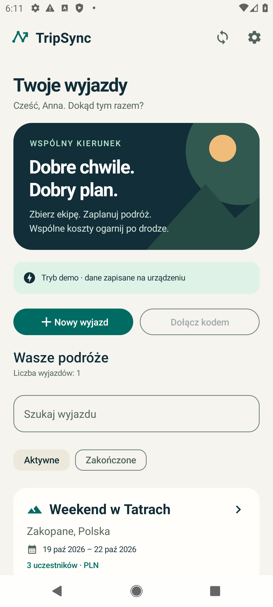
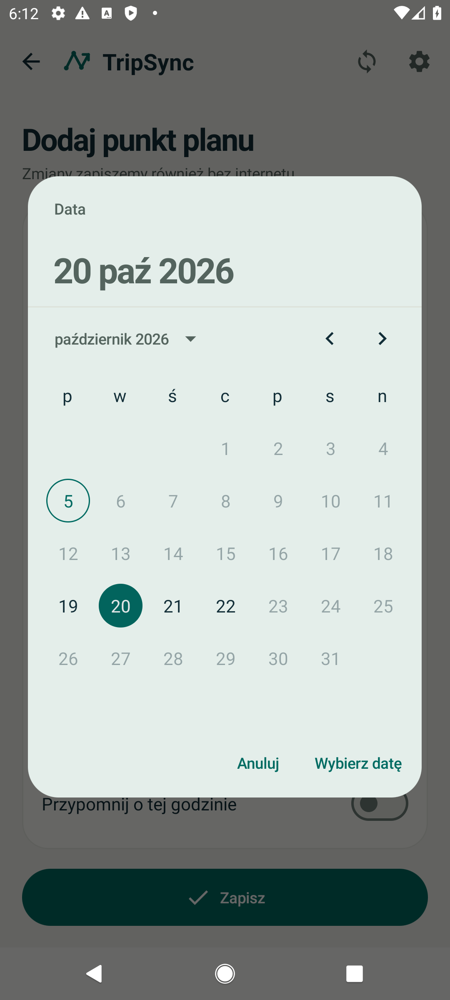
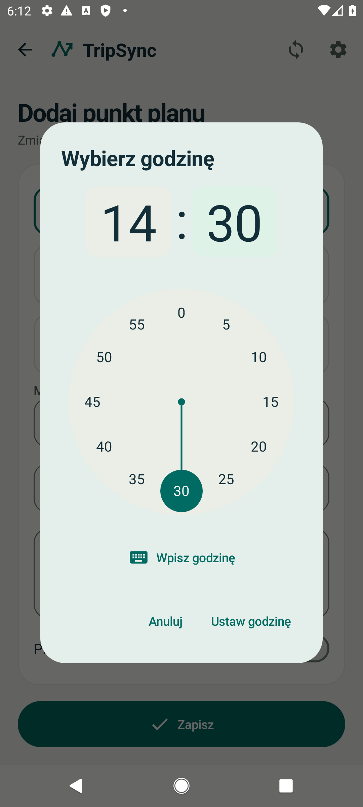

# TripSync


Aplikacja Android do organizacji wyjazdów grupowych: harmonogram, głosowanie, zadania, pakowanie, wydatki, kategorie, budżety, spłaty, historia zmian oraz mapa miejsc z prognozą pogody. Wersja 1.2.0. Działa offline i synchronizuje dane przez własne API REST. Projekt dla zespołu trzyosobowego.

## Interfejs 1.2

Odświeżony wygląd, kalendarze i zegar 24-godzinny, wyszukiwanie i sortowanie kosztów, aktywne i zakończone wyjazdy, plan według dni, ochrona niezapisanego formularza oraz stan ładowania i ponowienie mapy. Szczegóły i poprawione błędy: [docs/ui-1.2.md](docs/ui-1.2.md).

<p>
  
  
  
</p>

## Szybki start

1. Zbuduj APK zgodnie z instrukcją poniżej albo pobierz `TripSync-debug` z artefaktów GitHub Actions po udanym przebiegu. W lokalnej paczce prezentacyjnej dostępny jest także `output/apk/TripSync-debug.apk`. Zainstaluj na Androidzie 8.0 lub nowszym.
2. Wybierz **Wypróbuj bez konta**. Przykładowy wyjazd jest w pełni edytowalny i nie wymaga serwera.
3. Aby współpracować z innymi użytkownikami, utwórz konto. Nowa instalacja ma domyślnie ustawiony serwer `https://tripsync.wisp.uno/`. Własny serwer można wybrać w ustawieniach przed zalogowaniem.

Tryb demonstracyjny nie udaje synchronizacji z innymi urządzeniami. Zmiany w demo są przechowywane wyłącznie lokalnie. Ponowne wejście do demo po wylogowaniu odtwarza zestaw przykładowy.

## Budowanie w Android Studio

Otwórz katalog projektu w Android Studio. Zainstaluj Android SDK 36.1 i Build Tools 36.0.0. Projekt korzysta z Gradle Wrapper 9.3.1, Android Gradle Plugin 9.1.1, wbudowanego Kotlina i kompilatora Compose 2.2.10. JDK 17 lub 21; w tym środowisku użyto JDK 21 z Android Studio.

Lokalny plik `local.properties` powinien wskazywać własny Android SDK. Nie jest wersjonowany.

```properties
sdk.dir=/sciezka/do/Android/sdk
```

```sh
./gradlew :app:assembleDebug
./gradlew :app:testDebugUnitTest
./gradlew :app:lintDebug
```

Jeżeli katalog projektu jest synchronizowany przez usługę chmurową, pliki budowania można umieścić poza nim: `./gradlew -PtripsyncBuildRoot=/tmp/tripsync-build :app:assembleDebug`. Wtedy APK powstaje w `/tmp/tripsync-build/app/outputs/apk/debug/`.

APK wynikowy: `app/build/outputs/apk/debug/app-debug.apk`. Jest podpisany kluczem debug i służy do prezentacji. Wersja release wymaga własnego podpisu. Przy pierwszym budowaniu potrzebne jest połączenie z repozytoriami Google Maven i Maven Central.

## GitHub Desktop i Wispbyte

Instrukcja publikacji: [docs/github-desktop.md](docs/github-desktop.md). W GitHub Desktop użyj **File → Add Local Repository** i wskaż ten katalog projektu, następnie **Push origin**, aby wysłać zatwierdzone zmiany do istniejącego repozytorium. Zachowaj historię i gałąź `main`.

Dla płatnego Wispbyte i MySQL: [docs/wispbyte.md](docs/wispbyte.md). Backend obsługuje MySQL przez PyMySQL; dane połączenia ustawia się w zmiennych środowiskowych, a hasło pozostaje w panelu hostingu. Konfiguracja nie przenosi automatycznie danych z lokalnej bazy SQLite.

Workflow `.github/workflows/checks.yml` wykonuje testy backendu, budowanie APK, testy jednostkowe Android i lint. Pierwszy przebieg w GitHub Actions wymaga publikacji repozytorium.

## Alternatywny darmowy hosting i prawdziwe dane

Gotowa instrukcja: [docs/hosting.md](docs/hosting.md). Polecany wariant to **PythonAnywhere Beginner Free** z trwałym plikiem SQLite oraz adapterem `backend/wsgi.py`. Wgraj trzy pliki backendu, ustaw WSGI i wpisz adres HTTPS hostingu w aplikacji przed rejestracją. Każdy uczestnik używa własnego konta i tego samego serwera. Demo nie trafia na backend. Działający serwer projektu znajduje się pod adresem `https://tripsync.wisp.uno/`; ten rozdział opisuje alternatywny hosting.

## Nowe funkcje 1.1

- Łączny budżet i limity sześciu kategorii, wskaźnik wykorzystania, ostrzeżenia o przekroczeniu oraz filtr wydatków.
- Własne deklaracje spłat: CRUD, przeliczenie sald i pozostałych przelewów. Aplikacja nie wykonuje transakcji bankowych; każdy zapisuje własną spłatę, pozostali ją widzą.
- Historia zaakceptowanych zmian z autorem i czasem serwera; klient nie może wysyłać fałszywych wpisów. Obejmuje dołączanie, zaproszenia i operacje rekordów, bez pełnego porównania wartości przed/po. Ekran pokazuje 200 najnowszych wpisów.
- Współdzielone miejsca: CRUD współrzędnych, mapa Leaflet/OpenStreetMap, otwarcie w aplikacji map i wybór zapisanej nazwy w planie/pomysłach.
- Wyszukiwanie miejscowości oraz 7-dniowa prognoza Open-Meteo, bez klucza API dla niekomercyjnego projektu. Temperatury, opis pogody i szansa opadów; ostatnia prognoza jest zapisana lokalnie z datą pobrania. Wyszukiwarka nie jest katalogiem wszystkich punktów POI.

Mapa potrzebuje internetu do kafelków; zapisane miejsca i ostatnia prognoza pozostają lokalnie. Prognoza dotyczy najbliższych dni, nie dowolnie odległego terminu wyjazdu. Przepisywanie współrzędnych do map/pogody nie wymaga uprawnienia GPS. Użycie komercyjne Open-Meteo wymaga sprawdzenia warunków dostawcy. Leaflet 1.9.4 jest dołączony w assets z licencją; mapa nie ma mostka JavaScript do Androida, dane markerów są kodowane przez Gson, nawigacja WebView jest blokowana.

## Uruchomienie backendu

Wariant lokalny SQLite: Python 3.10 lub nowszy, wyłącznie biblioteka standardowa, bez instalowania pakietów. Wariant MySQL wymaga `backend/requirements-mysql.txt`.

```sh
python3 backend/server.py
```

Baza SQLite powstanie w `backend/tripsync.sqlite`. Endpoint kontrolny: `http://127.0.0.1:8080/health`.

W emulatorze Android ustaw w aplikacji: `http://10.0.2.2:8080/`. Przed lokalnymi testami wpisz ten adres ręcznie; nowe instalacje korzystają domyślnie z publicznego serwera TripSync. Współdzielenie można sprawdzić na dwóch emulatorach z dwoma oddzielnymi kontami.

Na telefonie podłączonym przez USB można użyć lokalnego tunelu:

```sh
adb reverse tcp:8080 tcp:8080
```

Wtedy ustaw `http://127.0.0.1:8080/`. Dla urządzeń poza lokalnym tunelem użyj HTTPS z certyfikatem zaufanym przez Android:

```sh
python3 backend/server.py --host 0.0.0.0 --port 8443 --cert /sciezka/fullchain.pem --key /sciezka/privkey.pem
```

Alternatywnie uruchom API za reverse proxy HTTPS. Publiczne udostępnienie i konfiguracja domeny nie są wykonywane automatycznie. Wersja release blokuje cały nieszyfrowany HTTP. W debug HTTP jest dopuszczone jedynie dla `10.0.2.2`, `127.0.0.1` i `localhost`.

## Wspólny wyjazd

1. Anna rejestruje konto i tworzy wyjazd.
2. Po synchronizacji otwiera **Uczestnicy i zaproszenia → Pokaż kod zaproszenia**.
3. Bartek na drugim urządzeniu rejestruje własne konto i używa **Dołącz kodem**.
4. Obie osoby dodają elementy i wybierają ikonę synchronizacji.
5. Po odłączeniu sieci zmiany pozostają w lokalnej kolejce; po połączeniu WorkManager ponawia synchronizację. Można również użyć przycisku synchronizacji.
6. Przy równoczesnej edycji tego samego rekordu pojawia się ekran konfliktów. Każda osoba wybiera swoją wersję albo wersję serwera.

Kod zaproszenia ma 12 znaków. Organizator może go unieważnić przez wygenerowanie nowego. Link `tripsync://join?code=KOD` otwiera aplikację; po zalogowaniu kod trafia do formularza dołączenia. Dodawanie uczestników i uwierzytelnianie wymagają sieci.

## Testowanie

```sh
python3 -m unittest discover -s backend -v
./gradlew :app:testDebugUnitTest
```

Testy urządzeniowe obejmują interfejs oraz rzeczywistą komunikację dwóch niezależnych repozytoriów Android z API. Przed ich uruchomieniem włącz osobny backend testowy na porcie 8080 i uruchom emulator. Testy integracji ustawiają adres `http://10.0.2.2:8080/` i nie tworzą kont na publicznym serwerze:

```sh
./gradlew :app:connectedDebugAndroidTest
```

Testy używają losowych kont w bazie serwera. Zalecana oddzielna baza testowa:

```sh
python3 backend/server.py --db tmp/test-server.sqlite
```

Zrzuty ekranów z testu `mainScreensAndRealScreenshots` trafiają do `Android/data/pl.tripsync/files/screenshots` na urządzeniu. Materiały końcowe i wyniki wykonanych testów znajdują się w `docs/` i `output/`. Gradle może usunąć aplikację po testach; aby zachować screeny, zainstaluj oba APK i uruchom sam test screenów przez `adb shell am instrument -w -e class 'pl.tripsync.TripSyncUiTest#mainScreensAndRealScreenshots' pl.tripsync.test/androidx.test.runner.AndroidJUnitRunner`, a potem pobierz katalog przez `adb pull`.

## Struktura

| Katalog | Zawartość |
|---|---|
| `app/src/main/java/pl/tripsync/ui` | Ekrany Compose, formularze, motyw i ViewModel |
| `app/src/main/java/pl/tripsync/domain` | Modele, walidacja, dokładne obliczenia pieniężne |
| `app/src/main/java/pl/tripsync/data` | Room, API Retrofit, repozytorium, sesja i ustawienia |
| `backend` | API REST, SQLite lub MySQL, konfiguracja hostingu i testy |
| `docs` | Dokumentacja funkcjonalna, diagramy i zrzuty ekranu |
| `output` | APK, PDF i paczka do przekazania |

## Założenia i ograniczenia

Jedna waluta na wyjazd (PLN, EUR lub USD), bez przeliczania kursów. Maksymalnie 100 uczestników. Rozliczenia są propozycją przelewów; aplikacja nie realizuje płatności. Algorytm zachowuje dokładność groszy i ogranicza liczbę przelewów do co najwyżej n−1 dla n osób z niezerowym saldem; nie gwarantuje globalnego minimum.

Synchronizacja jest oparta na pełnym pobraniu dostępnych wyjazdów, a nie na transmisji w czasie rzeczywistym. Synchronizacja okresowa ma interwał co najmniej 15 minut i zależy od ograniczeń systemu. Usunięcie uprawnień jest skuteczne na serwerze natychmiast, a lokalne dane zostają usunięte przy następnej udanej synchronizacji. Telefon całkowicie offline zachowuje wcześniej pobraną kopię.

Powiadomienia są lokalne, wymagają zgody od Androida 13 i mogą być opóźnione przez system. Nie używają alarmów dokładnych. Wylogowanie usuwa lokalną bazę i niewysłane zmiany. Dane aplikacji znajdują się w prywatnym katalogu Android, sesja jest szyfrowana AES-GCM kluczem Keystore, a kopie zapasowe aplikacji są wyłączone. Sama baza Room nie jest dodatkowo szyfrowana SQLCipher.

Backend jest rozwiązaniem dydaktycznym: pojedyncza instancja procesu, SQLite lub MySQL i serializowane operacje zapisu. Nie zawiera odzyskiwania hasła, weryfikacji e-mail ani infrastruktury monitoringu produkcyjnego. Nie ma czatu, rezerwacji, map offline ani automatycznego wykrywania atrakcji.

## Dokumentacja bibliotek

- [Android Gradle Plugin](https://developer.android.com/build/releases/gradle-plugin)
- [Jetpack Compose i BOM](https://developer.android.com/develop/ui/compose/bom)
- [Room](https://developer.android.com/training/data-storage/room)
- [WorkManager](https://developer.android.com/topic/libraries/architecture/workmanager)
- [Android Keystore](https://developer.android.com/privacy-and-security/keystore)
- [Retrofit](https://square.github.io/retrofit/)

## Repozytorium

Repozytorium: [Yamoteusz/TripSync](https://github.com/Yamoteusz/TripSync). Zmiany zapisane lokalnie można wysłać przez **Push origin** w GitHub Desktop.

## Odtworzenie historii i materiałów

Paczka ZIP zawiera foldery projektu i plik `TripSync-history.bundle`. Historię można odtworzyć w oddzielnym katalogu:

```sh
git clone TripSync-history.bundle TripSync-z-historia
```

APK jest załącznikiem prezentacyjnym; nie jest dodawane do historii Git. Po zmianach można odbudować je przez `scripts/build.sh`. Dokumentację PDF można odtworzyć przez `python3 scripts/create_documentation.py` po zainstalowaniu pakietu `reportlab`; wymagane są dołączone screeny, wyniki JSON oraz czcionka Arial albo DejaVu Sans. Gotowa dokumentacja nie wymaga tych narzędzi do odczytu.

Po zatwierdzeniu zmian polecenie `python3 scripts/package_project.py` tworzy ZIP, Git bundle i sumy SHA-256. Nie publikuje projektu w zdalnym repozytorium.

Dokumentacja PDF poprzedniego wydania 1.1 to `output/pdf/TripSync_dokumentacja_projektu.pdf`. Plik `TripSync_zalozenia_projektu.pdf` zachowuje pierwotną propozycję sprzed rozbudowy.

Konfiguracja płatnego Wispbyte, GitHub i opcjonalnego MySQL: [docs/wispbyte.md](docs/wispbyte.md).

Zmiany i wyniki aktualnego wydania: [UI 1.2](docs/ui-1.2.md), [wyniki testów 1.2](docs/test-results-1.2.json).
