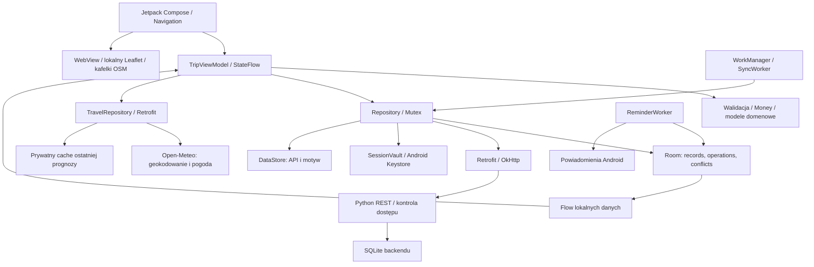
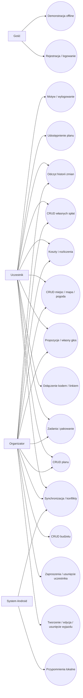
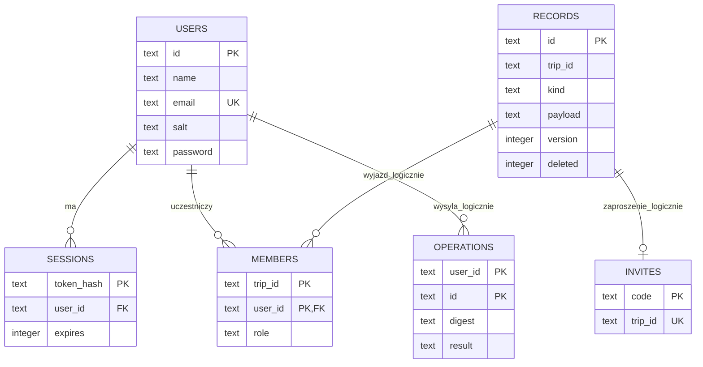
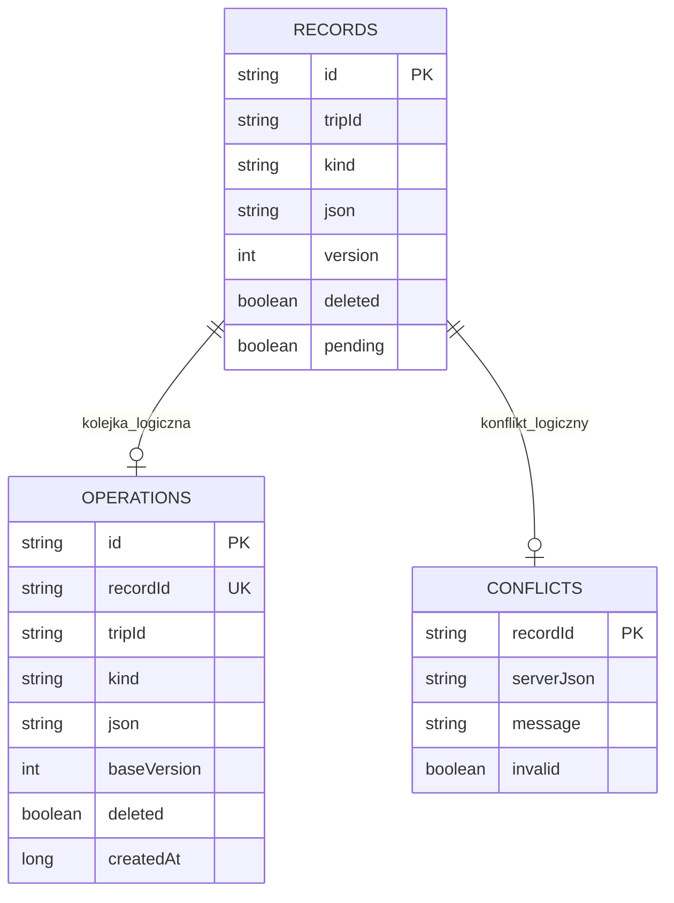

# Architektura TripSync

## MVVM i przepływ danych

Źródłem danych dla ekranów jest Room. Każdy zapis danych i powiązanej operacji odbywa się w jednej transakcji. ViewModel zbiera reaktywne strumienie i publikuje stan UI. Mutex serializuje zapisy, uwierzytelnianie, wylogowanie i synchronizację. CoroutineWorker uruchamia synchronizację w tle po spełnieniu warunku dostępności sieci.

Repozytorium używa DTO na granicy sieci; rekordy przechowują typowany logicznie payload JSON. Jedna tabela rekordów pozwala zastosować jednolity protokół wersjonowania dla wszystkich modułów. Walidacja spójności relacji odbywa się w repozytorium/UI i na backendzie; indeksy i klucze główne są fizyczne, relacje do pól JSON są logiczne.

## Synchronizacja

1. Zapis lokalny aktualizuje rekord i operację w transakcji. Kolejna edycja tego samego rekordu zastępuje oczekującą operację nowym identyfikatorem, zachowując bazową wersję.
2. Klient wysyła operacje w kolejności zależności: wyjazdy, propozycje, pozostałe dane, głosy. Maksymalnie 100 operacji na żądanie.
3. Serwer sprawdza sesję, dostęp do wyjazdu, rolę, dane i bazową wersję rekordu.
4. Ponowienie już przyjętej operacji z tym samym identyfikatorem i treścią zwraca poprzedni wynik bez kolejnego zapisu.
5. Różnica wersji tworzy konflikt, zamiast nadpisywać dane. Operacje konfliktowe nie są wysyłane automatycznie do czasu decyzji użytkownika.
6. Klient pobiera pełny snapshot dostępnych wyjazdów. Oczekujące lokalne edycje nie są nadpisywane snapshotem.
7. Utrata dostępu powoduje usunięcie wyjazdu, jego kolejki, konfliktów i przypomnień z urządzenia po udanej synchronizacji.
8. Usunięcia są reprezentowane tombstone. Wyjazd usunięty przez organizatora przestaje być dostępny wszystkim uczestnikom. Głosy mogą być ponownie dodawane po cofnięciu.

Przy utracie odpowiedzi serwera i kolejnej edycji klient może otrzymać konflikt również dla własnej wcześniejszej zmiany. Mechanizm zachowuje dane i wymaga świadomego rozstrzygnięcia.

## Bezpieczeństwo

Hasła backendu: PBKDF2-HMAC-SHA256, losowa sól i 260 000 iteracji. Tokeny sesji: 48 losowych bajtów przed kodowaniem URL-safe, w bazie wyłącznie SHA-256 tokenu, ważność 7 dni. Porównanie hashy hasła jest stałoczasowe. Limiter logowania/rejestracji: 30 prób na adres IP w 5 minut, w pamięci procesu.

Autoryzacja jest egzekwowana na serwerze. Tylko organizator edytuje i usuwa wyjazd, generuje zaproszenia i usuwa uczestników. Każdy uczestnik zarządza planem, zadaniami, propozycjami i kosztami; głosować może wyłącznie za siebie. Usunięcie uczestnika mającego aktywne wydatki wymaga wcześniejszej zmiany/usunięcia tych wydatków. Przypisania jego zadań i głosy są czyszczone przez serwer.

Aplikacja nie przekazuje tokenów po zmianie adresu API: adres można zmienić tylko bez zalogowanej sesji. Cleartext HTTP jest ograniczone do lokalnych hostów debug. Wydanie release wymaga HTTPS.

## Przypadki użycia

## Fizyczna baza backendu

Fizyczne FK dotyczą sessions.user_id i members.user_id. Powiązania z records i operations.user_id są logiczne, kontrolowane przez kod API. Tabela records przechowuje wyjazdy oraz rekordy podrzędne, wskazywane przez trip_id. Payload zawiera właściwe dane danego typu.

## Lokalna baza Room

Room ma indeksy records.tripId, records.kind i unikalny indeks operations.recordId. Nie deklaruje fizycznych FK pomiędzy tymi trzema tabelami; spójność jest utrzymywana przez transakcje repozytorium. Schemat wyeksportowany przez Room znajduje się w app/schemas.

## Budżety, spłaty, mapa i pogoda

Nowe typy JSON korzystają z istniejącej tabeli records i tego samego protokołu wersjonowania, więc schemat Room pozostaje w wersji 1. Starsze wydatki bez kategorii trafiają do „Pozostałe”. Saldo to zapłacone wydatki minus własne udziały, powiększone o wysłane spłaty i pomniejszone o otrzymane spłaty. Suma sald pozostaje zerowa. Nadpłata tworzy należność w przeciwnym kierunku; nie jest ukrywana.

Historia jest dopisywana po zaakceptowanym zapisie w tej samej transakcji SQLite. Serwer nie akceptuje activity od klienta. Pełny snapshot obejmuje historię, a ekran ogranicza wyświetlenie do 200 najnowszych wpisów. Nie ma paginacji ani mechanizmu cofania historii.

TravelRepository pobiera prognozy przez osobnego Retrofit bez tokenów kont. Błąd sieci pozostawia ostatnią zapisaną prognozę z czasem pobrania, datami i wyraźnym komunikatem. Zmiana wybranego miejsca anuluje poprzednie żądanie. Pogoda jest osobnym stanem ViewModel; nie trafia do współdzielonej kolejki operacji.

Leaflet 1.9.4 jest lokalną biblioteką w assets. WebView renderuje własny HTML, znaczniki używają JSON Gson oraz textContent, pliki i treści Android są niedostępne, brak JavascriptInterface. CSP ogranicza źródła do własnych skryptów/stylów i kafelków HTTPS. Link atrybucji otwiera zewnętrzną przeglądarkę. Włączenie JavaScript jest lokalnie oznaczone SuppressLint, ponieważ jest wymagane przez Leaflet; nie wyłączono ogólnie sprawdzeń bezpieczeństwa.

Adapter WSGI i samodzielny serwer używają tej samej logiki Handler/Store. Wariant PythonAnywhere Free zakłada pojedynczy worker. Rekomendacje większego wdrożenia wymagają przeglądu współbieżności i testów obciążenia. Alternatywny Caddy przekazuje IP tylko z jawnie zaufanego proxy; backend nie ufa dowolnemu X-Forwarded-For.
