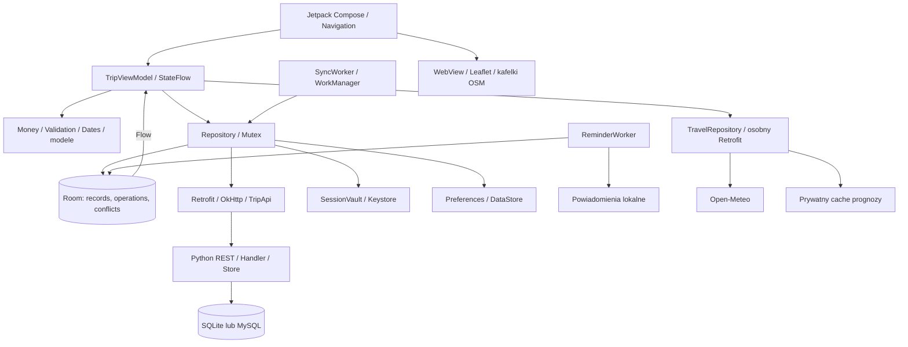

# Architektura i synchronizacja

## MVVM

TripSync wykorzystuje MVVM z wydzielonymi folderami domeny i danych. Jest jedną aplikacją Gradle, z osobnym backendem Python. Nie deklarujemy pełnej Clean Architecture ani osobnych modułów Gradle dla każdej funkcji.

- UI: ekrany Compose, formularze, Theme i Navigation w `ui/`.
- ViewModel: `TripViewModel` zbiera dane repozytorium i publikuje `AppState`, stan błędów, zajętości i pogody przez StateFlow.
- Domena: typowane modele, Money, Validation, Categories i Dates.
- Dane: Room, Repository, TripApi, TravelRepository, Preferences i SessionVault.
- Backend: Handler/Store, autoryzacja, wersjonowanie i adapter SQLite lub MySQL.

Wersja ilustracyjna: [diagram SVG](diagrams/architektura.svg).

## Lokalny zapis i przepływ danych

Źródłem danych ekranów jest Room. Formularz waliduje wejście; repozytorium zapisuje rekord oraz operację oczekującą w jednej transakcji. DAO emituje Flow, a ViewModel aktualizuje StateFlow. Ekran zbiera go zgodnie z cyklem życia. Operacje Room/Retrofit są asynchroniczne; pliki i szyfrowana sesja są obsługiwane poza głównym wątkiem.

Mutex repozytorium porządkuje zapisy, logowanie, wylogowanie i synchronizację. Odtworzenie aktywności zachowuje ViewModel i wybrane dane formularza przez rememberSaveable. Dane trwałe pozostają w Room; filtry i przewinięcie zakładek są dodatkowo pamiętane w ViewModel w bieżącej sesji.

## Protokół synchronizacji

1. Rekord lokalny i operacja mają identyfikatory, typ, payload i bazową wersję serwera. Ponowna edycja rekordu zastępuje oczekującą operację nowym ID, zachowując bazową wersję.
2. Klient wysyła maksymalnie 100 operacji w batchu, według zależności: wyjazd, propozycja, pozostałe dane, głos.
3. Serwer sprawdza token, dostęp, rolę, dane i `baseVersion`. Poszczególne operacje są odrębnymi transakcjami, nie jedną transakcją całej paczki.
4. Zaakceptowany zapis zwiększa wersję i dopisuje historię w tej samej transakcji. Ponowienie tej samej operacji z tą samą treścią zwraca poprzedni wynik bez duplikatu.
5. Inna wersja bazowa tworzy konflikt. Operacja oczekuje na decyzję o danych lokalnych lub serwera; nie jest automatycznie nadpisywana.
6. Snapshot obejmuje wszystkie dostępne wyjazdy, bez paginacji. Uzupełnia Room i zachowuje niewysłane edycje lokalne.
7. Usunięcie jest przesyłane jako tombstone. Odebranie dostępu usuwa lokalny wyjazd, kolejkę, konflikty i przypomnienia po udanej synchronizacji.

Jeśli odpowiedź serwera zaginie, a klient zmieni rekord ponownie, konflikt może dotyczyć jego własnej wcześniej przyjętej edycji. Mechanizm zachowuje dane, ale wymaga rozstrzygnięcia.

## Praca w tle i integracje

SyncWorker ma warunek sieci; okresowe zadanie ma minimalny interwał 15 minut i zależy od Androida. ReminderWorker obsługuje lokalne przypomnienia, bez gwarancji dokładnej godziny.

TravelRepository używa osobnego Retrofit bez tokenu TripSync. Prognoza jest cache'owana lokalnie, a zmiana miejsca anuluje poprzednie żądanie. Pogoda nie trafia do współdzielonej kolejki. Mapa jest własnym HTML w WebView, z lokalnym Leaflet i kafelkami HTTPS.

WSGI oraz samodzielny serwer używają wspólnej logiki Store/Handler. Hostowana konfiguracja tworzy Store z adapterem MySQL albo SQLite. Operacje backendu są porządkowane przez blokadę jednego procesu; skalowanie na wiele procesów nie zostało zweryfikowane.
