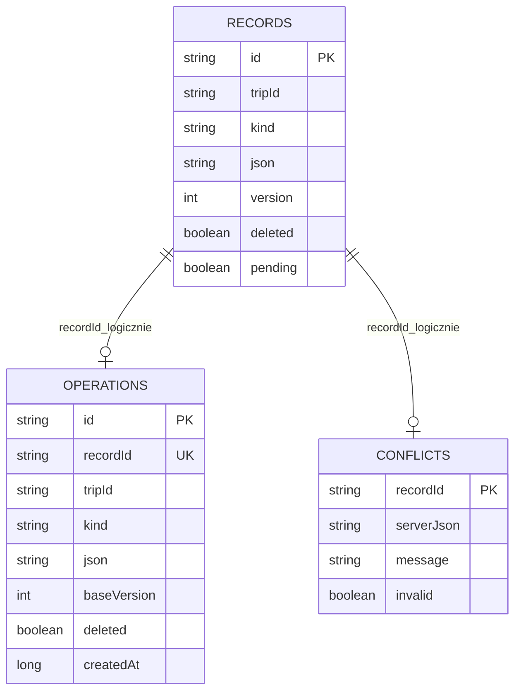
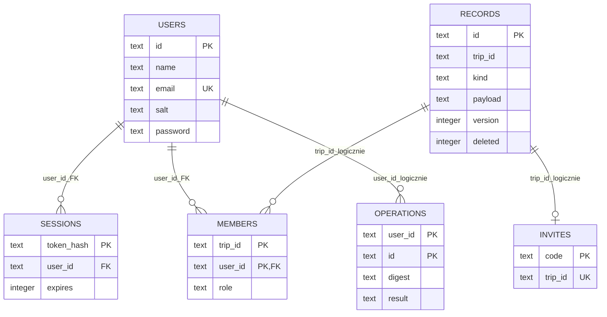

# Bazy danych i model informacji

## Dlaczego rekordy z payloadem JSON

Wiele typów danych współdzieli identyfikator, wyjazd, wersję i znacznik usunięcia. Jedna tabela rekordów umożliwia jednolity protokół offline i konfliktów. Payloady są reprezentowane typowanymi modelami Kotlin, a spójność referencji jest sprawdzana przez repozytorium i serwer. To świadoma alternatywa wobec osobnej tabeli każdego typu; część relacji nie jest egzekwowana przez FK.

## Room na urządzeniu

Schemat wersji 1 znajduje się w `app/schemas/pl.tripsync.data.TripDatabase/1.json`. Wersja Android 1.2 nie zmienia fizycznego schematu.

[Diagram SVG](diagrams/baza-lokalna.svg). `records` ma indeksy `tripId` i `kind`. Unikalny indeks `operations.recordId` zapewnia jedną oczekującą operację na rekord. Powiązania diagramu są logiczne; Room nie deklaruje FK pomiędzy tymi trzema tabelami. Zapis rekordu i operacji odbywa się transakcyjnie. Konflikt przechowuje dane serwera i komunikat.

## Backend SQLite / MySQL

Oba warianty mają sześć tabel. MySQL używa InnoDB, utf8mb4 i collation utf8mb4_bin; adapter tłumaczy parametry zapytań i operację zastępującą rekord. SQLite włącza FK i WAL. Adapter nie migruje automatycznie istniejącej SQLite do MySQL.

[Diagram SVG](diagrams/baza-backendu.svg). Typ `text` na diagramie jest opisem wspólnego modelu; MySQL stosuje ograniczone VARCHAR, LONGTEXT, BIGINT i TINYINT według `backend/mysql_database.py`. Pole `password` zawiera hash, nie hasło jawne. `expires` to czas Unix w sekundach; czas historii `at` jest w milisekundach.

Fizyczne FK: `sessions.user_id` i `members.user_id` do `users.id`. Relacje do wyjazdu w `records`, operacji użytkownika i pól payloadu są logiczne. Tabela `operations` backendu przechowuje wyniki już obsłużonych operacji dla idempotencji; lokalna tabela o tej samej nazwie jest kolejką oczekującą. Nie należy utożsamiać ich funkcji.

## Payloady rekordów

| kind | Model / dane |
|---|---|
| trip | TripData: tytuł, cel, daty, waluta, opis |
| member | MemberData: userId, nazwa i rola |
| event | EventData: tytuł, data, godzina, miejsce, opis, rank, wykonanie i reminder |
| task | TaskData: kategoria, assignee, termin, wykonanie i reminder |
| proposal | ProposalData: tytuł, miejsce i opis |
| vote | VoteData: proposalId i userId |
| expense | ExpenseData: kwota, payer, shares, data i category |
| budget | BudgetData: limit i categoryLimits |
| settlement | SettlementData: from, to, amount, data i note |
| place | PlaceData: tytuł, latitude, longitude i opis |
| activity | ActivityData: autor, akcja, rodzaj, tytuł i czas serwera |

Wyjazd ma `id=tripId`, członkostwo `id=tripId:userId`, głos `id=proposalId:userId`, budżet `id=budget:tripId`. Pozostałe rekordy otrzymują ID. Daty kalendarzowe są ISO `YYYY-MM-DD`; godziny to `HH:mm`. Kwoty to całkowite grosze/centy. Kategoria nieobecna w starszym koszcie jest interpretowana jako `other`.

## Integralność i trwałość

Serwer sprawdza istnienie powiązanych osób i wyjazdu, własność głosu/spłaty, sumę udziałów oraz ograniczenia waluty. Waluty nie można zmienić po zapisaniu aktywnych kosztów, budżetu lub spłat. Usunięcie użytkownika z wyjazdu z aktywnymi powiązaniami finansowymi jest ograniczone. Zniknięcie uprawnień jest odtwarzane na urządzeniu po synchronizacji.

Zapis JSON rozszerza modele bez zmiany schematu Room; każda przyszła zmiana fizycznego schematu wymaga osobnej strategii migracji. Lokalna baza nie jest szyfrowana SQLCipher. Kopie SQLite wykonuje `backend/backup.py`; MySQL wymaga eksportu bazy na hostingu.
