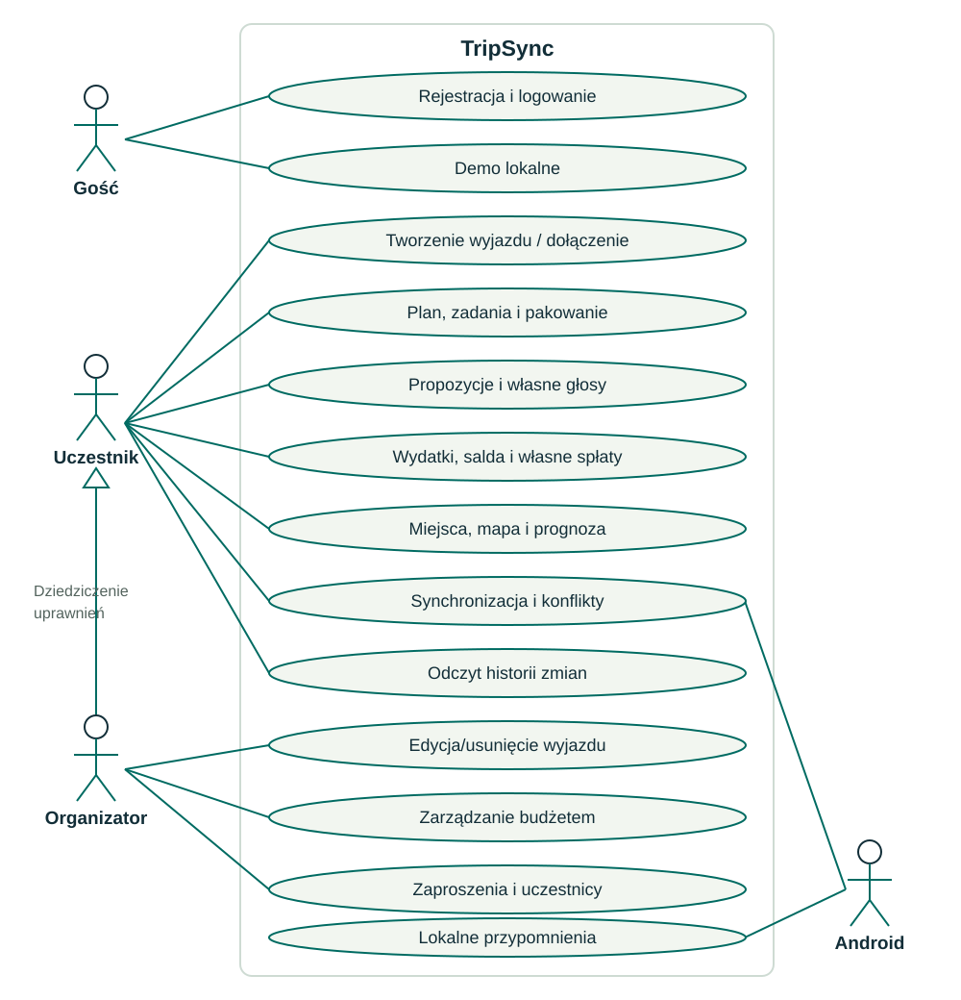

# Przypadki użycia

## Diagram UML

Aktorzy znajdują się poza granicą systemu. Organizator jest specjalizacją uczestnika i dziedziczy jego przypadki użycia; dodatkowo zarządza wyjazdem, grupą i budżetem. System Android realizuje zadania w tle. Diagram grupuje powiązane działania CRUD dla czytelności; macierz poniżej precyzuje dostęp.

## Macierz uprawnień

| Działanie | Gość | Uczestnik | Organizator |
|---|---|---|---|
| Konto / demo | Tak | Po wylogowaniu | Po wylogowaniu |
| Utworzenie wyjazdu | Nie | Tak, staje się organizatorem nowego wyjazdu | Tak |
| Edycja/usunięcie istniejącego wyjazdu | Nie | Nie | Tak |
| Dołączenie kodem/linkiem | Nie | Tak | Tak |
| CRUD planu, zadań, propozycji, miejsc i kosztów | Tylko lokalne demo | Tak | Tak |
| Głosowanie | Tylko demo | Za siebie | Za siebie |
| Spłata: zapis/edycja/usunięcie | Tylko demo | Własna | Własna |
| Zapis/edycja/usunięcie budżetu | Tylko demo | Nie | Tak |
| Odczyt budżetu, historii i danych wyjazdu | Tylko demo | Tak | Tak |
| Kod zaproszenia i jego rotacja | Nie | Nie | Tak |
| Usunięcie uczestnika | Nie | Nie | Tak, z ograniczeniami finansowymi |
| Synchronizacja / konflikty | Nie w demo | Tak | Tak |

Rola jest przypisana do konkretnego wyjazdu, nie globalnie do konta. Uprawnienia są egzekwowane przez backend; demo działa lokalnie jako organizator przykładu.

## UC01 - Utworzenie i udostępnienie wyjazdu

Warunek: użytkownik jest zalogowany. Tworzy wyjazd, wybiera daty oraz walutę, zapisuje i synchronizuje. Backend tworzy członkostwo organizatora. Użytkownik otwiera uczestników i pobiera kod. Druga osoba dołącza, synchronizuje i widzi dane. Nieprawidłowy kod, brak sesji lub sieci daje komunikat; lokalny zapis wyjazdu może oczekiwać w kolejce przed wygenerowaniem zaproszenia.

## UC02 - Zapis planu offline

Warunek: wyjazd znajduje się w lokalnej bazie. Użytkownik dodaje punkt z datą w terminie wyjazdu i poprawną godziną. Room zapisuje rekord i operację. Ekran odświeża się bez internetu. Po odzyskaniu sieci synchronizacja przesyła zmianę. Błędne dane są odrzucane; konflikt wersji prowadzi do UC04.

## UC03 - Zapis kosztu i spłaty

Uczestnik wpisuje dodatnią kwotę, płatnika i udziały sumujące się do kosztu. Salda aktualizują się lokalnie. Nadawca zapisuje własną spłatę z datą nie późniejszą niż dziś; saldo uwzględnia ten zapis. Nie jest wykonywany przelew bankowy. Edycja cudzej spłaty jest odrzucana na serwerze.

## UC04 - Konflikt edycji

Dwie osoby zmieniają ten sam rekord na tej samej wersji bazowej. Serwer przyjmuje pierwszą operację; drugiej zwraca aktualny rekord jako konflikt. Użytkownik wybiera wersję serwera albo ponawia własną na nowej wersji bazowej. Ponowienie może ponownie wejść w konflikt, jeśli nastąpiła kolejna równoczesna zmiana.

## UC05 - Mapa i pogoda

Uczestnik zapisuje miejsce lub wybiera miejscowość z wyszukiwarki. Mapa pokazuje znacznik, a prognoza dane dla najbliższych siedmiu dni. Przy braku sieci mapa pokazuje błąd, lista miejsc pozostaje dostępna, a pogoda może wyświetlić oznaczony datą cache. Nie jest pobierany GPS telefonu.
